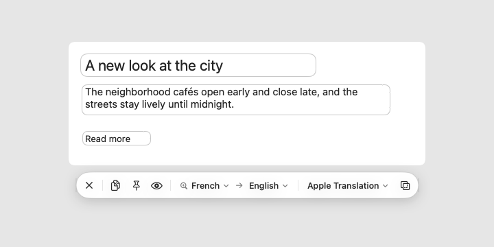
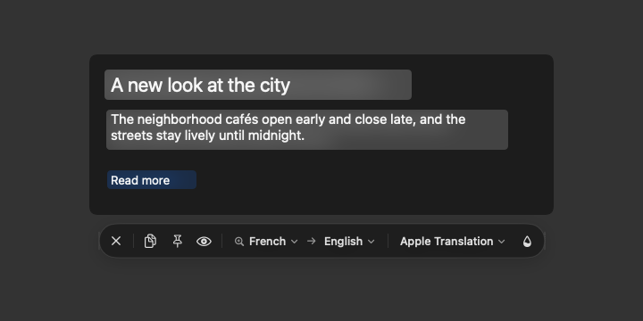
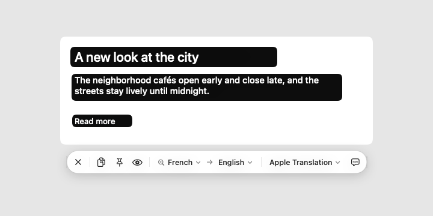
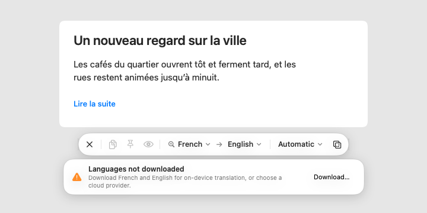
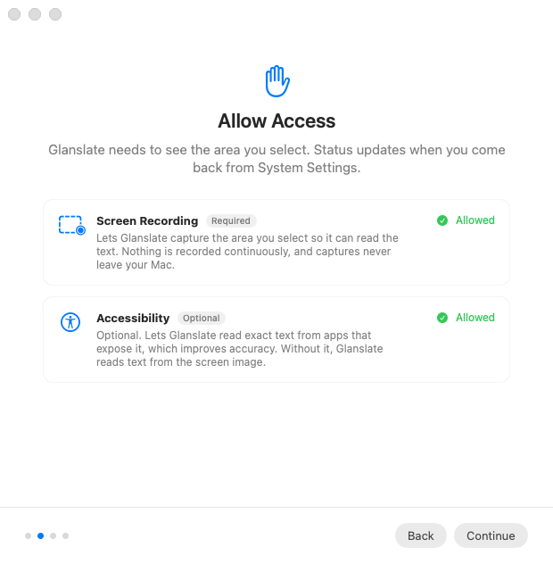

# Glanslate

Glanslate is a macOS menu bar utility that translates text anywhere on your screen and shows the translation right on top of the original.

Press **⇧⌘T**, drag over text in a browser, PDF, image, or app (or press Space to pick a window), and Glanslate does the rest: it captures the area, reads the text on your Mac, detects the language, translates it, and lays the translation over the source, keeping its position and paragraph structure. Hold **⌥** to peek at the original.

- Native Swift, SwiftUI, and AppKit for macOS 26 Tahoe, with Liquid Glass surfaces, SF Symbols, and system typography.
- Light and dark mode, Increase Contrast, Reduce Transparency, and Reduce Motion are all supported.
- Capture (ScreenCaptureKit) and text recognition (Vision) never leave your Mac.
- Translation through Apple Translation (on device), DeepL, Google Cloud Translation, or OpenAI, with a fallback you control.
- Updates itself from GitHub Releases, after checking each download's Developer ID signature and that it runs on your Mac.

| Liquid Glass | Blur Patch (dark content) | Subtitle |
|---|---|---|
|  |  |  |

| Actionable errors | Onboarding | Selection hints |
|---|---|---|
|  |  |  |

These images are rendered by CI on macOS 26 (see *Tests*). The offscreen renderer can't draw system materials, so glass looks flatter than on screen and the sidebars of the Settings and Saved Translations windows come out blank.

## Requirements

- macOS 26 or later
- Xcode 26 or later to build

There are no third-party dependencies.

## Build and run

1. Open `Glanslate.xcodeproj`.
2. Choose the **Glanslate** scheme and **My Mac**, then press **⌘R**.
3. Glanslate appears in the menu bar (the translate icon). On first launch a short guide walks you through permissions and setup.

**Signing.** The project signs the app to run locally, so it builds without an Apple developer account. macOS ties privacy permissions to the app's signature, though, and a locally signed build gets a new signature every time you build. That means macOS asks for Screen Recording permission again after each rebuild. To avoid this during development, sign with your team:

```sh
cp Configs/Local.xcconfig.example Configs/Local.xcconfig
# then set DEVELOPMENT_TEAM in Configs/Local.xcconfig
```

`Local.xcconfig` is ignored by git.

## Permissions

| Permission | Needed for | Required |
|---|---|---|
| Screen & System Audio Recording | Capturing the area you select | Yes |
| Accessibility | Reading the exact text that apps expose, to correct recognition mistakes | No |

The welcome guide and **Settings › General** show the live status of each permission and open the right System Settings pane. The status updates when you come back to Glanslate.

After you allow Screen Recording, macOS sometimes applies the change only after a restart. Glanslate offers a **Restart Glanslate** button when that happens.

Without Accessibility access, Glanslate works fully from the screen image alone (OCR).

## Using Glanslate

**Selecting**

- Drag to select an area. Selections stay on the display where you start them, and a size label shows the selection's dimensions.
- Press **Space** to switch to window selection, then click a window. Press Space again to go back to area selection.
- Press **Esc**, or right-click, to cancel.
- If a selection is too small, or the drag leaves the display, a hint explains what to do and the selection stays open.

**The overlay toolbar** appears next to the region, below it when there's room and above it otherwise:

| Control | Action | Key |
|---|---|---|
| ✕ | Close the overlay | esc |
| Viewfinder | Select and translate another region | ⌘N |
| Copy | Copy the translation | ⌘C |
| Pin | Save to, or remove from, Saved Translations | ⌘S |
| Eye | Show the original (hold ⌥ for a quick peek) | ⌘O |
| Source ▾ → Target ▾ | Change languages. Source can be detected automatically | |
| Provider ▾ | Choose Automatic or a specific provider | |
| Style ▾ | Liquid Glass, Blur Patch, or Subtitle | |

Changing the language or provider retranslates the text already recognized; Glanslate doesn't capture again. The current translation stays visible while the new one loads. If you change your mind quickly, an older response never replaces a newer one.

You can also right-click a translated block to copy that block or its original, and select translated text directly.

**Overlay styles**

- **Liquid Glass** shows translated text on subtle glass surfaces aligned with the original. The original glyphs are blurred beneath the glass, so the text stays readable on any background.
- **Blur Patch** blurs away the source text beneath each translated block, using a tint sampled from the content behind it.
- **Subtitle** shows high-contrast captions. You can set the background (with opacity), text color, outline, and border. Settings warns you about color pairs with low contrast.

Settings › Appearance includes a live preview on light and dark content, plus a text size control.

**Saved Translations.** Pinned results are kept on this Mac, with the source text, translation, language pair, provider, time, and an optional image of the captured area. Open them from the menu bar to search, copy, delete one, or clear all (which asks you to confirm first).

## Translation providers

| Provider | What you need | Notes |
|---|---|---|
| **Apple Translation** | Nothing. Languages download on demand | Runs entirely on this Mac. Needs a known source language; Glanslate detects it automatically. Download language pairs in **Settings › Translation › Apple Translation**, or under System Settings › General › Language & Region › Translation Languages. |
| **DeepL** | A DeepL API key (Free or Pro) | Keys ending in `:fx` use the Free endpoint automatically. Uses `POST /v2/translate` with header authentication. When your monthly quota runs out, Glanslate says so (HTTP 456). |
| **Google Cloud Translation** | A Google Cloud API key with the Cloud Translation API and billing enabled | Uses Cloud Translation – Basic (v2), the edition that accepts API keys (Advanced/v3 requires OAuth service accounts). The key is sent in a header, never in the URL. |
| **OpenAI** | An OpenAI API key | Uses the Responses API with a strict JSON schema and `store: false`. The model defaults to `gpt-5.4-mini` and can be changed in Settings. Usage is billed to your account. |

**Choosing providers.** In **Settings › Translation** you pick a preferred provider and an optional fallback.

- With **Prefer on-device translation** turned on (the default), Glanslate uses Apple Translation whenever the pair's languages are already downloaded, even if you prefer a cloud provider.
- The fallback is used only when the preferred provider can't translate. For example: the pair is unsupported, the languages aren't downloaded, the key is missing, or there's a network error or rate limit.
- When you pick a provider explicitly in the overlay toolbar, Glanslate uses only that provider.

**Keys and verification.** API keys are stored in your login Keychain, never in preferences. Each provider has a **Verify** button that checks the key with a request that contains none of your text: `/v2/usage` for DeepL, a one-word sample for Google, and `/v1/models` for OpenAI.

## Updates

Glanslate checks GitHub once a day for a newer release and, when it finds one, shows a short notice and an **Update to Glanslate…** item in the menu bar. **Settings › About › Software Update** shows the release notes and an **Install and Relaunch** button, a **Check Now** button, **Skip This Version**, and the switch for automatic checks. **Check for Updates…** is also in the menu bar menu.

Before replacing itself, Glanslate makes sure the download is genuine and will work:

- The archive matches the SHA-256 digest GitHub publishes for it. (GitHub lists digests for release files; if one is missing, this check is skipped and the signature check below still applies.)
- The app inside has Glanslate's bundle identifier and exactly the version the release names, so a mislabeled release can't downgrade you.
- Its code signature is valid and comes from a Developer ID Application certificate of the same team that signed the running copy.
- It runs on this Mac: its minimum macOS version is no newer than yours, and it's built for your Mac's processor.
- What's installed is still older than the update. If another copy of Glanslate already installed something as new or newer, Glanslate leaves it alone.

If any check fails, nothing changes. When all pass, Glanslate swaps the new copy in and relaunches, keeping the previous copy aside until the new one has started. If the new copy doesn't open, Glanslate puts the previous one back and says so.

Glanslate offers the release page instead when it can't update in place: when it runs from the disk image or a folder you can't change, when it's a locally signed build, or when the release has no zip.

## Privacy

- Captures stay in memory and are never written to disk, except for an optional thumbnail when you pin a translation.
- Text recognition (Vision) and language detection (NaturalLanguage) run on device.
- Apple Translation runs on device.
- **Cloud providers.** Before Glanslate sends anything to a cloud provider for the first time, it explains what will be sent and asks for permission. Only the recognized text, plus the language names for OpenAI, is sent; the screenshot never is. If you decline, the provider is never used automatically, including as a fallback. You can change these choices in Settings › Translation.
- **Logs.** Glanslate logs only counts, providers, and error categories. It never logs credentials, captured images, or text.
- **Update checks** ask `api.github.com` for the latest release. The request includes Glanslate's version number along with what any web request carries, such as your IP address and preferred languages; nothing you've captured, translated, or configured. Turn checks off in Settings › About.
- Translation requests use an ephemeral session with no cache or cookies, 15-second request timeouts, and at most one retry for transient server errors. Update downloads also use an ephemeral session, with a 30-second timeout between data and 10 minutes in total.

## Architecture

The domain is modeled first, in a Foundation-only module. Each platform concern lives in its own module behind a narrow interface.

```
Glanslate (app target)          main.swift, asset catalog, Info.plist
└─ GlanslateInterface           Menu bar, selection UI, overlay + toolbar, Settings, onboarding,
   │                            Saved Translations, and GlanceController (the workflow)
   ├─ GlanslateCapture          ScreenCaptureKit capture that excludes Glanslate's own windows; window list
   ├─ GlanslateRecognition      Vision OCR, bounded Accessibility text reading, NaturalLanguage detection
   ├─ GlanslateAppleTranslation On-device TranslationSession engine and language availability
   ├─ GlanslatePersistence      SwiftData model and store for saved translations
   ├─ GlanslateSystem           Permissions, Keychain, Carbon hot keys, UserDefaults settings, displays,
   │                            and the update installer (download, checksum, signature check, swap)
   └─ GlanslateCore             Domain model and all pure logic (no platform frameworks):
                                  Language, TranslationProvider, GlanslateError (actionable messages)
                                  ScreenCoordinateSpace, CaptureGeometry, SelectionGeometry
                                  TextGrouper (paragraphs, reading order), AccessibilityTextMerger
                                  TranslationRouter (preference, fallback, consent), DeepL/Google/OpenAI adapters
                                  OverlayLayoutEngine, FloatingToolbarPlacement, LatestTaskRunner
                                  AppVersion, GitHubReleaseFeed (update checks)
```

**Coordinate spaces.** Glanslate converts explicitly between four coordinate spaces, all in `ScreenCoordinateSpace` and `CaptureGeometry`:

- AppKit global (bottom-left origin)
- Quartz global (top-left origin; used by window lists and Accessibility)
- display-local (top-left origin per display; used for selection, capture, and layout)
- capture pixels, plus Vision's normalized bottom-left space

Displays at negative origins and mixed Retina and non-Retina setups are covered by tests.

**Workflow.** `GlanceController` runs select → capture → recognize → translate → present as one cancellable task.

- Retranslations go through `LatestTaskRunner`. Starting a new request cancels the previous one, and a result is applied only if it's still the newest.
- Changing the display arrangement cancels selection and dismisses the overlay, since the coordinates are no longer valid.
- UI state lives on the main actor. Capture, recognition, and network work run off the main thread.

## Tests

```sh
swift test --package-path Packages/GlanslateKit
```

On macOS this runs every suite. On Linux it runs the GlanslateCore suites. In Xcode, **⌘U** on the Glanslate scheme runs the same tests. The suites cover:

- **Coordinate conversion.** AppKit/Quartz/display-local round trips, negative origins, stacked displays, Retina scaling, Vision normalized rects, and pixel cropping.
- **Selection geometry.** Clamping to a display, minimum size, and clipping windows to their display.
- **Text grouping.** Wrapped paragraphs, headings, lists, hyphenation, CJK joining, row fragments, and column-aware reading order.
- **Accessibility merge.** Corrections without duplicated text, ignoring hidden elements, and rejecting unrelated text.
- **Provider routing.** On-device preference, fallback, consent and refusal, explicit choice, undetected source, same language, and cancellation without fallback.
- **Provider adapters.** Request shape, authentication, language codes, batching, error mapping (quota, rate limit, invalid key, disabled service, model), and retry limits.
- **Cancellation and stale results.** Newer requests win and cancelled results are discarded.
- **Overlay layout and toolbar placement.**
- **Persistence.** Save, update, search, delete, and clear all.
- **Settings.** Persistence and hot key modifiers.
- **Updates.** Version comparison, reading GitHub releases (drafts, pre-releases, digests, rate limits), scheduling and skipping, one install at a time, putting the previous copy back when the new one doesn't open, and the installer refusing damaged, mislabeled, unsigned, or incompatible downloads and updates older than what's installed.

CI (`.github/workflows/ci.yml`) runs the core tests on Linux and, on a macOS 26 runner, the full package tests, the app build, and the scheme tests. It also renders every Settings section, each onboarding step, Saved Translations, the three overlay styles, and the selection hints in light and dark appearance, and uploads them as the `interface-snapshots` artifact for visual review. Include `[snapshots]` in a commit message to have CI refresh `Docs/Screenshots`. To render them locally:

```sh
GLANSLATE_SNAPSHOTS=/tmp/glanslate-snapshots swift test --package-path Packages/GlanslateKit --filter InterfaceSnapshotTests
```

**Manual checks.** The interface itself, capture, and permissions need a real session. Before a release, check:

- Light and dark mode.
- Increase Contrast, Reduce Transparency, and Reduce Motion (System Settings › Accessibility › Display).
- A second display placed to the left of and above the main one, with mixed Retina and non-Retina displays.
- Selections near display edges, and window selection across displays.

## Troubleshooting

- **"Screen Recording is off" after every build.** Sign with your team; see *Build and run*.
- **"No Team Found in Archive" despite selecting a team.** Use a signing certificate such as **Apple Development** for Release instead of **Sign to Run Locally**. Select your team on the Glanslate target for Release, then create a new archive; an existing locally signed archive has no team information.
- **"Languages not downloaded."** Choose **Download…** in the overlay message or in Settings › Translation. The system asks before downloading.
- **The shortcut doesn't work.** Another app may use it. Settings › Shortcuts says so when that happens. Record a different shortcut.
- **Google says the service needs setup.** Enable the Cloud Translation API and billing for the project the key belongs to.
- **"No releases found" when checking for updates.** The repository in `GLANSLATE_UPDATE_REPOSITORY` must be public and have a published, non-pre-release release.
- **Keychain prompts with locally signed builds.** Keychain access, like privacy permissions, is tied to the signature. Signing with your team avoids repeated prompts.

## Releasing

`scripts/release.sh` requires a local **Developer ID Application** certificate and private key for your team, plus a saved `notarytool` keychain profile. Create the certificate in **Xcode › Settings › Apple Accounts › Manage Certificates**, then save your notarization credentials once (enter the app-specific password at the hidden prompt):

```sh
xcrun notarytool store-credentials glanslate --apple-id you@example.com --team-id ABCDE12345
```

The script archives and exports a Release build signed with your team's Developer ID certificate, notarizes and staples the app for the updater ZIP, then creates, signs, notarizes, and staples the final DMG. It validates both signatures and tickets and checks Gatekeeper before optionally publishing. Missing credentials, rejected submissions, or failed verification stop the release.

Outputs are `build/Glanslate-<version>.dmg` and `build/Glanslate-<version>.zip`. Apple's submission results are saved in `build/Glanslate-app-notarization.plist` and `build/Glanslate-dmg-notarization.plist` for troubleshooting.

```sh
GLANSLATE_DEVELOPMENT_TEAM=ABCDE12345 NOTARY_PROFILE=glanslate scripts/release.sh
```

To ship an update:

1. Raise `MARKETING_VERSION` (and `CURRENT_PROJECT_VERSION`) in `Configs/Glanslate.xcconfig`, commit, and push.
2. Run the script with `PUBLISH=1`. It creates the GitHub release `v<version>` with both files, in the repository named by `GLANSLATE_UPDATE_REPOSITORY`, with notes from `RELEASE_NOTES` (a Markdown file) or generated by GitHub, and tags the commit it built.

Before building, publishing checks that the working tree is clean, the commit is pushed, `v<version>` isn't released yet, and any existing `v<version>` tag points at that commit. It also requires notarization.

```sh
GLANSLATE_DEVELOPMENT_TEAM=ABCDE12345 NOTARY_PROFILE=glanslate PUBLISH=1 scripts/release.sh
```

Running copies offer the newest release that isn't a draft or pre-release. Its tag must be a plain version (`v1.2.0`), and its first `.zip` asset is what gets installed. The repository must be public: Glanslate reads releases without signing in to GitHub. Set `GLANSLATE_UPDATE_REPOSITORY` to empty to build without update checks.

## Project layout

```
Glanslate.xcodeproj         Xcode project (app target + local package)
Glanslate/                  App target sources and asset catalog
Configs/                    Info.plist, entitlements, xcconfig
Packages/GlanslateKit/      Swift package with all modules and tests
scripts/                    Release (archive, notarize, DMG) and app icon generation
.github/workflows/ci.yml    Continuous integration
```
